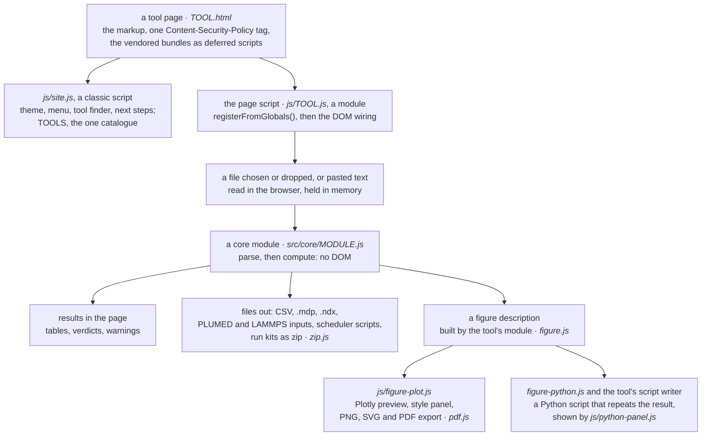
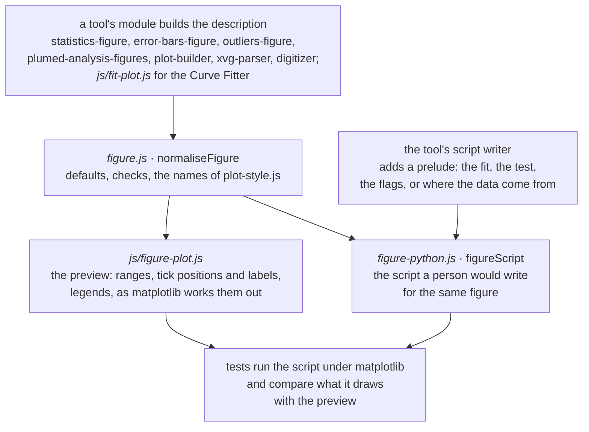
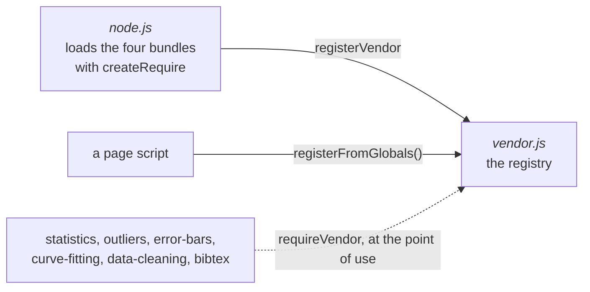
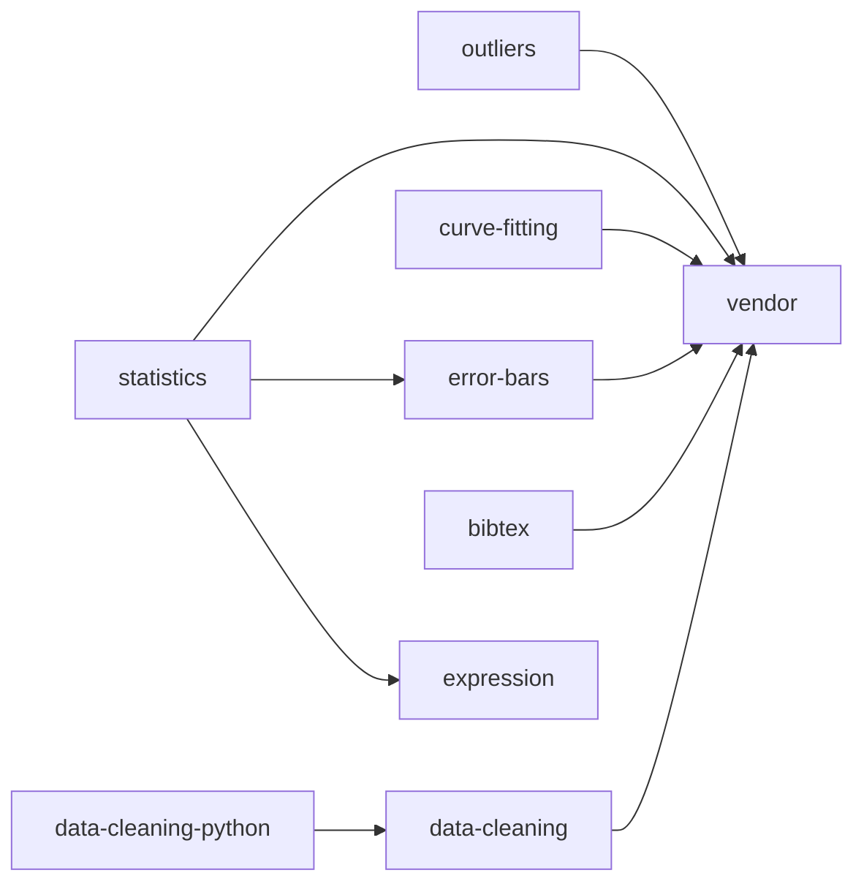
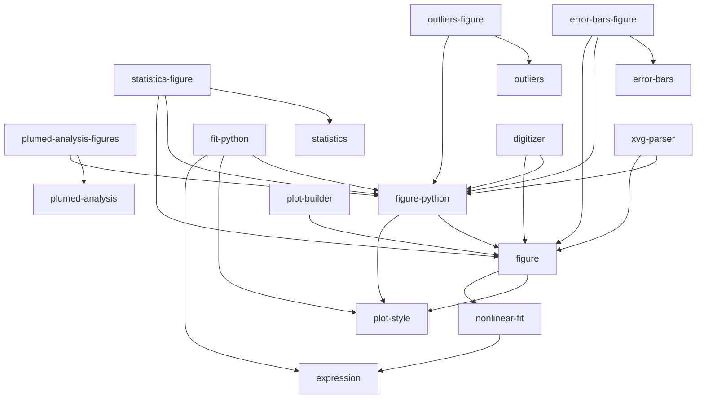
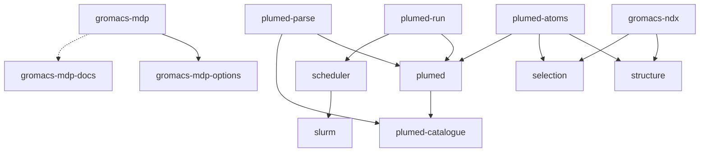
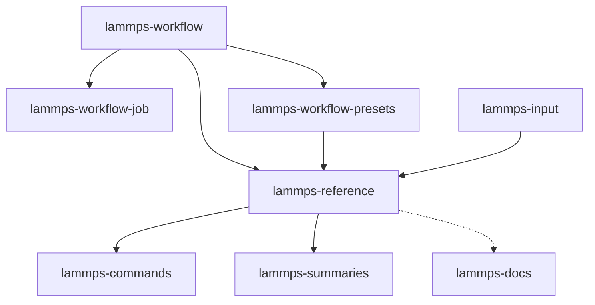

# Architecture

STEMKit is a set of browser tools and `stemkit-core`, the library under them. A
tool page reads a file in the browser, calls the core, and shows the result
with a figure and a Python script that repeats it. The same core modules run
under Node.js, so what was done on a page can be run again in a script. This
page maps the code onto that: what a page does, how a figure is built, how the
core gets its libraries, the modules and what they import, the files that are
generated, and where a change goes. The user documentation is the
[README](README.md) and <https://stemkit.net>; the library's API is in
[`src/core/README.md`](src/core/README.md); the layout, deployment and release
steps are in [`docs/SETUP.md`](docs/SETUP.md).

## A page, stage by stage

- **Chrome.** Every page carries the same header, theme script, tool names and
  footer, copied into each file because the pages have no build step;
  `tools/check-chrome.mjs` fails when the copies drift. `js/site.js` is loaded
  as a classic script before any page module, so its theme listener runs first.
  Its `TOOLS` array is the one catalogue: the tool finder, the home page
  search, the next-step links and the 404 suggestions all read it. Each page's
  head carries a Content-Security-Policy `<meta>` written by
  `tools/build-csp.mjs`: scripts, styles, fonts and requests from the site
  itself and, on the pages that need them, doi.org, RCSB and the YouTube
  player. Inline scripts run by hash, so editing one means running
  `npm run build:csp`.
- **Registration.** The four bundles the core uses (jStat, Papa Parse,
  regression.js, bibtex-parse-js) are UMD files that a page loads with
  `<script defer>`. They leave globals behind, and the page script's
  `registerFromGlobals()` hands those to the core (see below).
- **Input.** A file chosen or dropped, or text pasted, is read in the browser
  and held in memory. Nothing a person opens is sent anywhere; the three
  requests that leave the site, to doi.org, RCSB and the YouTube player, are
  named on `privacy.html`. A page that reads text asks `js/file-check.js`
  first: a file is held to the extensions the page names and to bytes that
  are text, so a workbook is refused, with what to do instead, and not shown
  as text. The same file decodes the text (UTF-16 by its byte-order mark,
  UTF-8, or the Windows code page a spreadsheet's plain CSV is in), and the
  page passes the encoding on to a script that reads the file.
- **Core.** A page script reads the form, calls the core and writes the result
  back. What decides a number is in `src/core/`, which touches no DOM. Page
  logic that needs a test sits in a DOM-free file beside its script (the
  `js/script-generator-*-model.js` files, the rules `js/decision.js` exports),
  so the tests run it in Node. Seventeen of the eighteen research tools run
  core modules. The Structure Inspector still keeps its computation in
  `js/structure-inspector.js`; `js/structure-inspector-selection.js`, the
  adapter that would let it use `selection.js`, exists and is not applied. The
  Pomodoro timer, the Decision Matrix and the kinetics sandbox have no
  computation to move (`docs/SETUP.md`, Conversion state).
- **Files out.** Text from the core: CSV, `.mdp`, `.ndx`, PLUMED and LAMMPS
  inputs, scheduler scripts. The MD Workflow Generator packs a run kit with
  `zip.js` (stored entries, Unix permission bits kept). Figures export as PNG,
  SVG or PDF; `pdf.js` writes the PDF from the SVG Plotly exports.
- **Figures and scripts.** Next section.

## One figure, two renderings

A figure is a plain object, not a drawing: panels, series, axes, and the style
names `plot-style.js` defines, which `figure.js` extends. Two readers take it
from there. `js/figure-plot.js` draws the Plotly preview and makes the decisions
matplotlib makes on its own the same way: axis ranges with matplotlib's 5%
margins, tick positions (the locators are ported), tick labels, legend
placement. `figure-python.js` writes the matplotlib script a person would write
for the same figure, reading the data from their own files or embedding them.

The two are held to each other by the tests. `tests/figure-python.test.js` and
the figure tests of each page run the script under matplotlib, when Python with
numpy, scipy and matplotlib is installed, and compare what it draws with the
preview; `docs/FIGURES.md` says which matplotlib versions each comparison
covers. The tool's script writer adds what the description does not carry: the
Curve Fitter's (`fit-python.js`) refits the model with
`scipy.optimize.curve_fit`; the Statistics Calculator's, the Error Bar
Generator's and the Outlier Detector's (`statisticsScript`, `errorBarScript`,
`outlierScript`) recompute the test, the summaries or the flags before they
draw.

## How the core is wired

- **Entry points.** In `package.json`, `"."` resolves to `src/core/node.js`
  under Node and to `src/core/index.js` everywhere else, and `"./*"` to
  `src/core/*.js`. A path import such as `stemkit-core/lammps-input` skips
  `node.js`, so it registers nothing.
- **Injection.** The bundles are UMD files: they detect their host when they
  run and either assign `module.exports` or attach a global, and a plain ES
  import binds neither. So a module asks the registry for a library when it
  needs it, not when it loads: `requireVendor('jStat')` throws a long, specific
  message if nothing was registered. Six modules ask: `statistics`, `outliers`
  and `error-bars` for jStat, `curve-fitting` for regression.js,
  `data-cleaning` for Papa Parse and `bibtex` for bibtex-parse-js. The Needs
  column of `src/core/README.md` lists the modules built on them. `node.js`
  loads the bundles from `js/dependencies/` with `createRequire` and calls
  `registerVendor`; `hasVendor` and `resetVendor` check and clear the registry;
  a test file that needs a library imports `tests/setup.js`, which registers the
  bundles the way `node.js` does.
- **The barrel.** `index.js` exports every module as a namespace (44: the 42
  domain modules, `Vendor` and `Version`) and a flat set of names. A name that
  two modules define is exported flat from one and reached through the
  namespace for the other: `mean`, `median` and `sd` come from `statistics`,
  `columnStats` from `xvg-parser` (a sample SD; `DataCleaning.columnStats` is
  the population one) and `formatValue` from `digitizer`.
- **Tables loaded on request.** The large generated tables are not imported
  with the module that reads them. `loadSyntax(version)` imports
  `plumed-syntax/v2.9.js`, `v2.10.js` or `v2.11.js`, about 60 kB compressed
  each; `loadMdpDocs()` imports `gromacs-mdp-docs.js`, the text of every `.mdp`
  option; `loadLammpsDetails()` imports `lammps-docs.js`, about 85 kB of
  keywords, units and defaults. `loadIso4(text)` is different: it builds the
  ISO 4 engine from the LTWA list, which the Journal Abbreviator fetches from
  `abbr/abbreviation.csv`.
- **The release.** `version.js` holds `STEMKIT_VERSION` and `RELEASE_DATE`, which
  a script can print for a methods section. `tests/version.test.js` holds them
  to `package.json`, `CITATION.cff` and the changelog, and
  `tools/check-chrome.mjs` holds every page footer to them.

## Modules

Arrows point from a module to one it imports; a dashed arrow is an import made
on request (`import()`). The libraries, and the statistics that build on them:

The figures, from each tool's module down to the typed equations:

GROMACS and PLUMED, which share the structure and selection modules and, for
the PLUMED run files, the scheduler:

LAMMPS:

Not drawn: `index`, which re-exports every module; `node`, which imports
`vendor` and `index`; and nine modules that import none of the others and are
imported by none: `units`, `latex`, `journals`, `iso4`, `pdf`, `zip`,
`lammps-data`, `plumed-syntax` and `version`. The pages and the barrel use them
directly.

Files and text.

| module | what it holds |
| :-- | :-- |
| `xvg-parser.js` | GROMACS and Grace `.xvg` files and other numeric tables, with Grace's quotes and escapes, and a spreadsheet's semicolons, decimal commas and quoted values; column statistics; the XVG Visualizer's figure (`xvgFigure`) and its script |
| `structure.js` | PDB, GRO and XYZ: parsing, `elementSymbol` and the ion table `ION_ELEMENTS`, masses, centre of mass, radius of gyration, principal axes, rotations, the steps as equations and as a Python script (`transformScript`), format conversion |
| `selection.js` | the atom selection language and spatial neighbour queries, with no 3Dmol.js behind it, so the language runs in Node |
| `units.js` | 64 units in 10 categories, plus temperature; CODATA 2018 / SI 2019 factors, rounded once (`UNIT_DB`, `convert`) |
| `data-cleaning.js` | tabular cleaning, deduplication, imputation and profiling; every operation returns a new array. `readTable` makes out a table's delimiter (or columns set apart by spaces), decimal mark and header row; the Outlier Detector, the Statistics Calculator and the Error Bar Generator read with it too |
| `data-cleaning-python.js` | the pandas script that repeats a cleaning recipe and writes the same CSV |
| `latex.js` | LaTeX and Markdown tables, text escaping |
| `bibtex.js` | BibTeX parsing, duplicate detection by union-find on DOI and title, field sanitising |
| `journals.js` | whole-title journal abbreviation from a dictionary |
| `iso4.js` | ISO 4 word-level abbreviation from the ISSN LTWA list |
| `digitizer.js` | pixel-to-data mapping by a two-point calibration per axis (a log axis in log space); the digitised series' figure and script |
| `pdf.js` | a PDF writer with no dependencies: vector pages from SVG, or a JPEG page |
| `zip.js` | a zip archive of text files, stored not compressed |

Statistics, fitting and figures.

| module | what it holds |
| :-- | :-- |
| `statistics.js` | descriptives, t-tests, classic and Welch ANOVA, correlation, rank tests, post-hoc comparisons, assumption checks (`leveneTest`, `dagostinoNormality`) and `recommendTest`; distributions from jStat, the normal tail from the `erfc` of `expression` |
| `outliers.js` | Z-score, modified Z-score, Tukey's fences and Grubbs' test |
| `error-bars.js` | group summaries, SD, SEM and confidence intervals, Holm-corrected Welch comparisons |
| `curve-fitting.js` | preset models through regression.js, goodness of fit and adequacy checks |
| `expression.js` | typed equations: parsing into a syntax tree and compiling to closures, with no `eval`; exact derivatives; LaTeX; `erfc` |
| `nonlinear-fit.js` | Levenberg–Marquardt fitting of a typed equation, with standard errors, confidence intervals and bands that match `scipy.optimize.curve_fit`; Student's t quantiles |
| `fit-python.js` | the script that repeats a fit with `curve_fit` and draws its figure |
| `plot-style.js` | how a fitted plot looks, one description for the preview and the script; `bandVisibility` |
| `figure.js` | the figure description and `normaliseFigure` |
| `figure-python.js` | `figureScript`, the matplotlib script that draws a description |
| `plot-builder.js` | the Plot Builder: a table read as the script's `csv` and `float()` read it (with a decimal comma, without a header or set out in columns, where the file is so), the figure of each of its nine chart kinds, panel layouts, fifteen built-in examples |
| `statistics-figure.js`, `error-bars-figure.js`, `outliers-figure.js`, `plumed-analysis-figures.js` | the figure and the Python script of the Statistics Calculator, the Error Bar Generator, the Outlier Detector and the PLUMED "Analyse a run" tab |

Simulation inputs.

| module | what it holds |
| :-- | :-- |
| `slurm.js` | SLURM batch scripts for GROMACS and LAMMPS, and the resource warnings (`arrayMemoryWarning`) |
| `scheduler.js` | directive headers, environment variables, launchers and submit commands for SLURM (through `slurm.js`), PBS Pro / OpenPBS, LSF and Grid Engine |
| `gromacs-mdp.js` | every `.mdp` option with its manual text; reading a file as grompp reads it, checking, explaining, and writing the usual stages. Reads the generated `gromacs-mdp-options.js` and loads `gromacs-mdp-docs.js` on request |
| `gromacs-ndx.js` | index groups: the `make_ndx` defaults, custom groups, `tc-grps` checks, the file itself |
| `plumed.js` | PLUMED input generation, version gating, collective-variable validation; the curated actions, fields and notes are in `plumed-catalogue.js` |
| `plumed-syntax.js` | access to the keyword tables of PLUMED 2.9, 2.10 and 2.11 (`plumed-syntax/`) |
| `plumed-parse.js` | reading an existing PLUMED input as PLUMED parses it: check, explain, open in the builder |
| `plumed-atoms.js` | atom lists, groups and per-molecule centres from a structure file, numbered as the engine numbers them |
| `plumed-analysis.js` | COLVAR and HILLS reading, hill width and grid suggestions, free-energy surfaces that match `sum_hills`, reweighting |
| `plumed-run.js` | the files a PLUMED job needs beside `plumed.dat`: walkers, umbrella windows, the job and queue scripts, a README |
| `lammps-reference.js` | every LAMMPS command and style of 29 Aug 2024: kind, package, accelerated variants, syntax. Reads the generated `lammps-commands.js` and the hand-written `lammps-summaries.js`, and loads `lammps-docs.js` on request |
| `lammps-input.js` | reading LAMMPS inputs as LAMMPS parses them, checking them as it runs them (also a chain of stages), explaining each line |
| `lammps-data.js` | reading LAMMPS data files: counts, box, types, charges, water model, SHAKE types, groups |
| `lammps-workflow.js` | a whole LAMMPS run as data: minimise, NVT, NPT and production inputs chained by restart files, the job block, a README. The force-field presets are in `lammps-workflow-presets.js` and the shell of the job block in `lammps-workflow-job.js` |

Plumbing.

| module | what it holds |
| :-- | :-- |
| `index.js` | the barrel: every module as a namespace, and the flat exports |
| `node.js` | the Node entry: `index.js` with the four bundles registered |
| `vendor.js` | the registry: `registerVendor`, `registerFromGlobals`, `requireVendor`, `hasVendor`, `resetVendor` |
| `version.js` | `STEMKIT_VERSION` and `RELEASE_DATE` |

## Generated files

| file | written by | from |
| :-- | :-- | :-- |
| `src/output.css` | `npm run build:css` (Tailwind) | `src/tailwind/input.css` and the classes the pages use |
| `sitemap.xml` | `npm run build:sitemap` | the pages, each dated by its last commit |
| the Content-Security-Policy tag of every page | `npm run build:csp` | the inline scripts of that page |
| `src/core/gromacs-mdp-options.js`, `gromacs-mdp-docs.js` | `npm run build:gromacs-mdp` | the GROMACS 2025.1 source: `docs/user-guide/mdp-options.rst` and the `.mdp` readers |
| `src/core/lammps-commands.js`, `lammps-docs.js` | `npm run build:lammps-docs` | the LAMMPS 29 Aug 2024 source: the style registrations in `src/` and `doc/src/*.rst` |
| `src/core/plumed-syntax/v2.9.js`, `v2.10.js`, `v2.11.js` | `node tools/build-plumed-syntax.mjs --source TREE --target VERSION` | the `syntax.json` of a compiled PLUMED tree, once per release |

The upstream trees (`gromacs-2025.1/`, `lammps/`, `plumed2/`) are git-ignored
and never committed. Six scripts under `tools/` hand what STEMKit writes or
checks to the installed program and compare its verdict: `npm run
check:gromacs`, `check:ndx`, `check:plumed`, `check:lammps`,
`check:lammps-data` and `check:lammps-workflow`.

## Where to make a change

| change | where |
| :-- | :-- |
| a parser, a calculation or a generator | a module in `src/core/` and `tests/<module>.test.js`; add it to `index.js` (a namespace, and flat exports if its names are specific), to the table in `src/core/README.md` and to Table 1 of the paper. `./run-tests.sh` reports where the paper's counts and the barrel disagree |
| a unit or a conversion factor | `UNIT_DB` in `units.js`; `tests/units.test.js` compares the factors with `scipy.constants` |
| a statistical test | `statistics.js`, its advice in `recommendTest`, its figure in `statistics-figure.js`, the page's wiring in `js/stats-calculator.js`; `tests/statistics.test.js` and `tests/statistics-figure.test.js` |
| an element, an ion or an atomic mass | `ATOMIC_WEIGHTS`, `TWO_LETTER_ELEMENTS` or `ION_ELEMENTS` in `structure.js`, which `gromacs-ndx.js` shares; `tests/structure.test.js` |
| a batch scheduler | `scheduler.js` (SLURM stays in `slurm.js`) and the page's adapter, `js/script-generator-slurm.js`; `tests/scheduler.test.js` |
| a GROMACS, PLUMED or LAMMPS version or option | regenerate the table (see above). The hand-written parts are `gromacs-mdp.js`, `plumed-catalogue.js`, `lammps-summaries.js` and `lammps-workflow-presets.js`; their tests are `tests/gromacs-mdp.test.js`, `tests/plumed-catalogue.test.js` and `tests/lammps-workflow.test.js` |
| a kind of figure | `figure.js` (the description), `figure-python.js` (the script), `js/figure-plot.js` (the preview) and `docs/FIGURES.md`; `tests/figure.test.js`, `tests/figure-python.test.js` and `tests/figure-plot.test.js` |
| a tool page | copy a page; an entry in `TOOLS` in `js/site.js`, a card on `index.html` and a link in the footer of every page; `src/tools/<tool>.css`; then `npm run build:css`, `build:csp` and `build:sitemap`, and `check:chrome` until it passes (`CONTRIBUTING.md`) |
| a vendored library | the file in `js/dependencies/`, its version in `THIRD_PARTY_LICENSES.md` (and `js/dependencies/LICENSES.md` for the four the package ships). A library that needs `eval`, a worker or another host also goes in the `EXTRA` table of `tools/build-csp.mjs`, then `npm run build:csp` |
| a release | the version in `package.json` and the lockfile, `src/core/version.js`, `CITATION.cff`, the changelog heading and every page footer (`docs/SETUP.md`); `tests/version.test.js` and `check:chrome` fail until they agree |
| the documentation | the READMEs and `docs/` by hand. The numbers the paper quotes are in `paper/preprint.md` and `paper/preprint.tex`, edited separately; `./run-tests.sh` says where the suite, the paper and the documents differ |

The test files follow the code by topic: `tests/<module>.test.js` for each
module; `tests/<tool>-page.test.js` for the helpers behind a page script,
`gromacs-ui` and `lammps-ui` for the MD Workflow Generator's `-model.js` files,
`slurm-form` for its scheduler adapter and `file-check` for the files a page
reads (the pages themselves are checked in a browser);
`plumed-crosscheck.test.js`, which records what PLUMED 2.9, 2.10 and 2.11 did
with what the builder writes, and `plumed-program.test.js`, which runs the
real program; `site-tools.test.js` for `tools/build-sitemap.mjs` and
`tools/check-chrome.mjs`; and `version.test.js`. `tests/smoke.mjs`, which is
not a Jest file, imports the package by name as a user's script does. Reference
values are frozen from SciPy, NumPy, statsmodels, pandas, matplotlib, GROMACS,
PLUMED and LAMMPS; the tests that run those programs are skipped where they are
not installed (Python with numpy, scipy, matplotlib and pandas; `plumed`;
`GMX_BIN`; `LMP_BIN`). CI (`.github/workflows/ci.yml`) runs the suite and the
smoke test on Node 22 and 24, the suite again with Python on three
configurations, and the site checks; `draft-pdf.yml` builds the JOSS draft of
`paper/paper.md`. There is no linter: the style is that of the surrounding code
(`CONTRIBUTING.md`).
