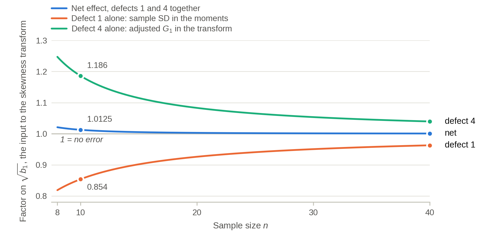
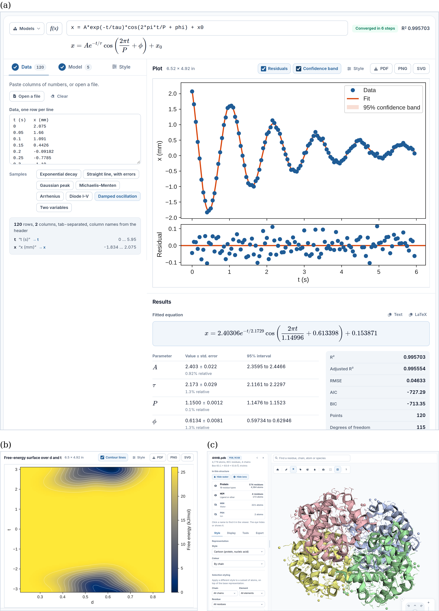
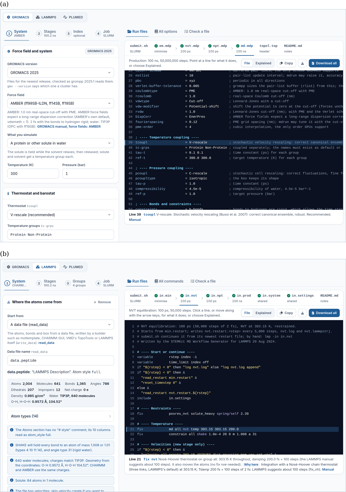

---
# The preprint (ChemRxiv), Markdown source. preprint.tex in this directory is
# the typeset version of the same text; paper.md is the short JOSS paper.
#
# Convert to .docx with:
#   pandoc preprint.md --bibliography=paper.bib --citeproc -o preprint.docx
title: "STEMKit: A client-side toolkit for computational chemistry and scientific data analysis"
author:
  - name: Olanrewaju M. Daramola
    orcid: 0009-0006-3327-2047
    affiliation: Independent Researcher
    email: lanrelangmuir@gmail.com
    corresponding: true
date: November 2026
keywords:
  - computational chemistry
  - molecular dynamics
  - client-side computation
  - GROMACS
  - reproducibility
  - data privacy
bibliography: paper.bib
---

# STEMKit: A client-side toolkit for computational chemistry and scientific data analysis

**Olanrewaju M. Daramola**
Independent Researcher
ORCID: [0009-0006-3327-2047](https://orcid.org/0009-0006-3327-2047)
Corresponding author: lanrelangmuir@gmail.com

## Abstract

STEMKit is a suite of 18 browser-based tools for computational chemistry and
scientific data analysis, built on `stemkit-core`, a JavaScript library
of parsing and numerical routines with no DOM dependency. All computation runs
inside the user's own browser: the data analysed never leaves it, no account is
required and nothing is installed, so the tools stay usable for unpublished or
confidential data. The same modules run under Node.js, so an interactive
analysis can be captured as a version-pinned script. A suite of 5003 tests
checks the numerical results against independent references wherever one
exists (SciPy, NumPy, statsmodels, pandas, matplotlib, GROMACS, PLUMED, LAMMPS
and physical invariants), not against the implementation itself. That
validation exposed four defects that had been altering reported results, among
them *p*-values floored at zero and the mass of haem iron taken as fluorine's.
All four are corrected and covered by regression tests, and the changelog gives the versions affected.

## Keywords

Computational chemistry; molecular dynamics; client-side computation; GROMACS;
reproducibility; data privacy

## Metadata

| Nr | Code metadata description | Metadata |
| --- | --- | --- |
| C1 | Current code version | v0.6.0 |
| C2 | Permanent link to code/repository used for this code version | <https://github.com/LD-Shell/stemkit> ; archived on Zenodo under the concept DOI `10.5281/zenodo.21543112`, which resolves to the current release |
| C3 | Legal code license | MIT License |
| C4 | Code versioning system used | git |
| C5 | Software code languages, tools and services used | JavaScript (ECMAScript 2020 modules), HTML5, CSS3; Node.js; Jest; Tailwind CSS |
| C6 | Compilation requirements, operating environments and dependencies | Browser tools: any current browser supporting ECMAScript modules and the `FileReader` API; no installation and no build step. Library: Node.js ≥ 22 (continuous integration runs 22 and 24); on npm as `stemkit-core`. No runtime dependencies: jStat, Papa Parse, regression.js and bibtex-parse-js are vendored and bundled. `npm install` in a clone adds only the development dependencies (Jest, Tailwind CSS) |
| C7 | If available, link to developer documentation/manual | <https://github.com/LD-Shell/stemkit#readme>; per-module API documentation in `src/core/README.md`; hosted tools at <https://stemkit.net>; narrated video tutorials for every research tool at <https://www.youtube.com/playlist?list=PLAqgfbqFf32M> |
| C8 | Support email for questions | lanrelangmuir@gmail.com (issue tracker: <https://github.com/LD-Shell/stemkit/issues>) |

## 1. Motivation and significance

The software landscape of computational chemistry is well served at its
extremes. Simulation engines such as GROMACS [@abraham2015] and LAMMPS
[@thompson2022] are mature, extensively validated, and actively maintained;
analysis frameworks such as MDAnalysis [@michaud-agrawal2011mdanalysis] provide
comprehensive programmatic access to trajectory data. Between these poles lies a
substantial volume of routine work that neither category serves comfortably.

Consider the interval between completing a simulation and reporting it. A
researcher must inspect the RMSD to confirm equilibration, extract a radius of
gyration, convert a structure between the nanometre convention of GROMACS and
the ångström convention of the Protein Data Bank, compare replicate measurements
statistically, digitise a figure from a paper for comparison, abbreviate journal
titles in a reference list, and compose a scheduler script requesting an
appropriate resource allocation. None of these operations is intellectually
demanding. All of them are error-prone when performed by hand, and all of them
are performed repeatedly.

### 1.1 The friction problem

Three classes of solution exist, and each imposes a characteristic cost.

*Local scripting.* A Python environment with MDAnalysis, NumPy and SciPy
addresses every task listed above and is the correct instrument for sustained
analytical work. Its cost is environmental. Managed institutional workstations
frequently prohibit package installation; conda environments drift; and a script
written six months ago may no longer execute against the current interpreter.
For a researcher whose primary expertise is chemistry, not software
engineering, this cost is not negligible.

*Web services.* Server-side tools eliminate installation entirely but require
data transmission. For unpublished results, material subject to a
confidentiality agreement, or work under embargo, this is frequently prohibited
outright. Even where permitted, the transfer creates a record whose retention
policy the researcher does not control.

*Desktop applications.* Graphical applications avoid both problems but introduce
a third: they are difficult to script. An analysis performed by clicking cannot
readily be re-executed, version-controlled, or subjected to continuous
integration. In practice such an analysis is difficult to reproduce, even when
every step was recorded at the time.

### 1.2 The client-side position

Modern browsers provide a capable computational environment. The `FileReader`
API grants access to local files without transmission, and JavaScript engines are
fast enough for the data volumes involved. Under Node.js 24.0.1 on a laptop
with an Intel Core Ultra 7 155H processor and 15 GB of memory, the parser
sustains about 1.6 million rows per second, reading a two-million-row,
three-column, 72 MB `.xvg` in 1.2 s, and parses a million-atom, 79 MB PDB and
returns its centre of mass in 0.85 s (medians of five runs, reproduced by
`paper/benchmark.mjs`). The ceiling is memory, not
arithmetic, since `FileReader` materialises the whole file as a string; inputs
of a few hundred megabytes are practical, and beyond that a streaming reader
would be required. ECMAScript modules make it possible to organise that code
properly, instead of accumulating scripts.

STEMKit is built around these constraints. No server participates in the
computation, so no file or result is transmitted and users are not asked to
take a privacy policy on trust. Two features make a network request, and only
when asked to: the DOI lookup sends the DOIs entered to doi.org to retrieve
their bibliographic records, and the structure inspector can fetch an entry from
the Protein Data Bank by its four-character identifier. Neither sends a file or
a result. Every asset is vendored in the repository: there is no
content-delivery network, no analytics and no telemetry, and a local clone runs
with the network disconnected. Two other kinds of traffic exist and are stated
so that the claim is not read more broadly than it holds. The server that
hosts stemkit.net may log page requests, as any web server does (the privacy
page says what). And the tutorial video on a tool's page loads YouTube's player,
from `youtube-nocookie.com`, only when the user presses play; until then the page
shows a thumbnail served from STEMKit itself. The claim is that no user data or
result leaves the browser, not that no request is ever made. The reproducibility
property derives from a separate architectural decision: the numerical core is extracted
into modules with no dependency on the browser, so the identical code that
executes behind the interface also executes under Node.js.

### 1.3 Interactive and scripted use

The software is used in two ways, which share one implementation.
Interactively, the user opens a tool page at <https://stemkit.net> (or a local
clone) and selects a local file (a GROMACS `.xvg` series, a PDB or `.gro`
structure, a CSV of replicate measurements) and reads the result in the page.
The file is read through `FileReader`; it is never uploaded. Programmatically,
the same routines are imported from `stemkit-core` in a Node.js script, which
is the path taken once an exploratory analysis is to be fixed, version-pinned
and re-run. The seven plotting tools (the XVG visualiser, plot builder, curve
fitter, plot digitiser, error-bar generator, statistics calculator and outlier
detector) and the MD workflow generator's PLUMED run analysis additionally emit
a standalone matplotlib script that regenerates the figure from the same data,
and the data cleaner a pandas script that repeats its cleaning steps, so an
interactive result can be reproduced offline without the browser.

The sources for each part are cited where the corresponding functionality is
described in Section 2: GROMACS [@abraham2015] and LAMMPS [@thompson2022] for the
trajectory and job-script formats, PLUMED [@tribello2014] for collective-variable output,
MDAnalysis [@michaud-agrawal2011mdanalysis] as the reference framework for
trajectory analysis, 3Dmol.js [@rego2015], whose atom-selection syntax the
`selection` module mirrors, SciPy [@virtanen2020], NumPy [@harris2020] and
statsmodels [@seabold2010] as the validation references for the numerics, and
the primary statistical literature [@welch1947; @welch1951; @spearman1904;
@kruskal1952; @tukey1949; @kramer1956; @games1976; @dunn1964; @dagostino1973;
@brown1974; @holm1979; @iglewicz1993; @grubbs1969; @bonett2000] for the
implemented tests. Conversion factors follow CODATA 2018
[@tiesinga2021], and the numerical treatment of tail probabilities follows
standard practice for the incomplete beta and gamma functions [@press2007].

### 1.4 Related work

Four groups of existing software overlap with parts of STEMKit, and none covers
the same combination.

*Python in the browser.* Pyodide [@pyodide] and JupyterLite [@jupyterlite] run
CPython with NumPy and SciPy inside the page, with no installation and no
upload, so a notebook can reproduce in the browser the SciPy results used here
as validation references. This is the closest alternative and meets all three
requirements of Section 1.1 in principle. What it does not provide is a finished
interface: the analysis has to be written and debugged for each task. STEMKit
makes the opposite trade, with fixed and validated interfaces to a set of routine
tasks, and uses Python only in the scripts it exports.

*Figure digitising.* WebPlotDigitizer [@rohatgi_webplotdigitizer] also runs in
the browser and covers more plot types than the STEMKit digitiser, among them
polar, ternary and bar plots, with automatic extraction. The STEMKit digitiser is
narrower (a two-point calibration per axis, linear or logarithmic) and is not
offered as a replacement.

*Simulation input.* CHARMM-GUI [@jo2008charmmgui; @lee2016charmmgui] builds
solvated, membrane and ligand systems, assigns force-field parameters and writes
inputs for several engines, through a server to which the structure is uploaded.
STEMKit's MD workflow generator does none of that system building. It writes and
checks run parameters and job scripts for a system prepared elsewhere, and does
so locally.

*Viewers and cheminformatics.* Mol* [@sehnal2021] and 3Dmol.js [@rego2015] are
browser viewers; the structure inspector draws with 3Dmol.js. RDKit compiled to
WebAssembly [@rdkit] brings substructure search and descriptors to the browser.
STEMKit has no cheminformatics and does not compete here.

Alongside these, MDAnalysis [@michaud-agrawal2011mdanalysis] and the SciPy stack
remain the right tools for sustained scripted analysis. The contribution claimed
is the narrower combination of no installation, no upload, ready-made interfaces
for the post-simulation and set-up tasks of Section 1, and a tested core that
also runs as a library; no single capability in it is new.

## 2. Software description

The 18 research tools are the subject of this paper. Three further browser
utilities (a Pomodoro timer, a decision matrix and a kinetics sandbox) are
distributed from the same repository as general workflow aids; they are not part
of the scholarly contribution and are not described here, though they share the
presentation layer and so appear in the page counts below.

### 2.1 Software architecture

The original implementation followed the pattern common to browser tooling: each
of the 21 tool pages consisted of an HTML document paired with a single JavaScript
file combining event handling, rendering and computation. This arrangement is
expedient during development and progressively obstructive thereafter.
Computational logic entangled with DOM manipulation cannot be tested without a
browser, cannot be reused across tools, and cannot be invoked from a script.

The refactoring applied the *strangler fig* pattern: for each tool, the
mathematical and parsing logic was extracted into a pure module beneath
`src/core/`, a test suite was written against the extracted module, and the
original file was then reduced to DOM wiring that imports the new functions. The
user-visible interface is unchanged; the computation beneath it is now
independently addressable. Figure 1 shows the resulting layering and Table 1
enumerates the modules.

```
┌───────────────────────────────┐   ┌───────────────────────────────┐
│        Browser host           │   │         Node.js host          │
│  21 static HTML/CSS tool pages│   │  user analysis scripts        │
│  DOM wiring only;             │   │  5003-test Jest suite;        │
│  FileReader input             │   │  smoke test                   │
│  UMD bundles via <script>     │   │  UMD bundles: createRequire   │
└───────────────┬───────────────┘   └───────────────┬───────────────┘
                │                                   │
                └─────────────────┬─────────────────┘
                                  ▼
        ┌─────────────────────────────────────────────────┐
        │                 stemkit-core                    │
        │  42 DOM-free domain modules, aggregated by      │
        │  src/core/index.js                              │
        └─────────────────────────┬───────────────────────┘
                                  ▼
        ┌─────────────────────────────────────────────────┐
        │            Vendor injection layer               │
        │  registerVendor() · registerFromGlobals()       │
        └─────────────────────────┬───────────────────────┘
                                  ▼
        ┌─────────────────────────────────────────────────┐
        │             Vendored UMD bundles                │
        │  jStat · Papa Parse · regression.js ·           │
        │  bibtex-parse-js                                │
        └─────────────────────────────────────────────────┘
```

**Figure 1.** Architecture of STEMKit. Both hosts execute the identical core
modules; the only environment-specific code is the registration call that
supplies the vendored libraries.

**Table 1.** Modules of `stemkit-core`. Vendored dependencies are supplied by
injection; modules marked *none* operate without any third-party code. Related
modules share a row, and a row's tests include those of the page scripts built
on it (439 in all).

| Module | Domain | Tests | Dependency |
| --- | --- | ---: | --- |
| `gromacs-mdp`, `gromacs-ndx` | GROMACS `.mdp` settings and checks, index groups | 1168 | none |
| `plumed`, `plumed-syntax`, `plumed-parse`, `plumed-atoms`, `plumed-run` | PLUMED input generation and checking, atom groups, run files | 644 | none |
| `expression`, `nonlinear-fit`, `fit-python`, `plot-style` | Typed equations, Levenberg–Marquardt fitting, fit scripts | 459 | none |
| `lammps-reference`, `lammps-input`, `lammps-data`, `lammps-workflow` | LAMMPS commands, input checks, data files, run inputs | 355 | none |
| `bibtex` | Reference deduplication, sanitising | 236 | bibtex-parse-js |
| `statistics`, `statistics-figure` | Inferential and descriptive statistics | 199 | jStat |
| `data-cleaning`, `data-cleaning-python` | Tabular transformation, pandas script | 183 | Papa Parse |
| `figure`, `figure-python` | Figure description, matplotlib script | 167 | none |
| `structure` | Molecular geometry, PDB/GRO/XYZ, rigid transforms and their scripts | 171 | none |
| `xvg-parser` | GROMACS/PLUMED trajectory data | 162 | none |
| `slurm` | SLURM job scripts, resource checks | 124 | none |
| `plumed-analysis`, `plumed-analysis-figures` | COLVAR and HILLS analysis, free-energy surfaces | 121 | none |
| `iso4` | ISO 4 word-level abbreviation (LTWA) | 119 | none |
| `error-bars`, `error-bars-figure` | Group summaries, error bars | 107 | jStat |
| `units` | Physical unit conversion | 106 | none |
| `selection` | Atom selection, spatial queries | 94 | none |
| `curve-fitting` | Least-squares regression | 81 | regression.js |
| `outliers`, `outliers-figure` | Anomaly detection | 78 | jStat |
| `scheduler` | Scheduler directives and launchers | 74 | none |
| `plot-builder` | Plot builder tables and figures | 62 | none |
| `latex` | Table generation and escaping | 61 | none |
| `digitizer` | Figure digitisation | 57 | none |
| `pdf` | PDF export of figures | 56 | none |
| `journals` | Whole-title journal abbreviation | 53 | none |
| `version` | Release version and date | 5 | none |
| `zip` | Archives of generated files | 4 | none |
| (no module) | Page scripts and site tools with no module under them: the Decision Matrix, the method and how-to tabs, the sitemap and page checks | 57 | none |
| **Total** | | **5003** | |

Four third-party libraries are vendored within the repository for the core:
jStat for statistical distributions, Papa Parse for delimited-text parsing,
regression.js for curve fitting, and bibtex-parse-js for reference parsing. The
pages also vendor Plotly, KaTeX, 3Dmol.js and MathLive, which the core does not
use. Each of the four is distributed as a Universal Module Definition (UMD)
bundle, which assigns `module.exports` under CommonJS or a global on `window` in
a browser; a plain ECMAScript module can import neither form directly. Instead
of branching on the execution environment inside every module, which would leave
the core untestable in one of its two targets, the library declares the
libraries it requires and each host registers them at initialisation: under
Node.js the package's entry point, in a browser the page (Section 2.3). Modules
request their dependencies lazily, at the point of use, so importing any module
never fails merely because an unrelated library has not yet been registered. One
packaging detail follows: the repository declares `"type": "module"`, so the
directory of vendored bundles is scoped `"type": "commonjs"`, or Node.js would
parse the bundles as ECMAScript modules.

Counting differs by purpose. The core has 42 domain modules (Table 1). The
package exports 44 namespaces, the 42 plus `version` and the injection layer
`vendor`, which carry no domain logic. The test suite comprises 5003 tests in 66
suites: 4941 under the 42 domain modules, 5 for `version`, and 57 for page
scripts and site checks with no module under them (the last row of Table 1).
Statement coverage of `src/core/` is 89.5% and line coverage 93.6%. The suite's
governing principle is that numerical results are checked against *independent*
references, not against the implementation under test, since a test written from
the same source as the code confirms only internal consistency.
Reference values were obtained from SciPy [@virtanen2020] for t-tests, ANOVA,
post-hoc comparisons, correlation, non-parametric tests, quantiles and the
studentised range distribution, and from its `curve_fit` for non-linear fits,
their standard errors and confidence bands; from statsmodels [@seabold2010] for Welch's
ANOVA and multiple-comparison correction; from NumPy [@harris2020] for
regression coefficients and descriptive statistics;
from `scipy.constants` for every unit conversion factor; from pandas
[@mckinney2010] for the data cleaner's scripts, whose output is compared with
the page's cell by cell; from matplotlib [@hunter2007] for box-plot whiskers and
for the axis limits the generated figure scripts produce; from GROMACS 2025
[@abraham2015], through `grompp`, `make_ndx` and `select`, for `.mdp` checks,
index groups and selections; from PLUMED 2.9 to 2.11 [@tribello2014] for the
generated inputs, and from its `sum_hills` for free-energy surfaces; from LAMMPS
29 Aug 2024 [@thompson2022] for data files, input checks and the generated
inputs; and from physical invariants for structural geometry, specifically the
molecular weight and
centre of mass of water, the orthonormality of rotation matrices, the
preservation of interatomic distances under rotation, and round-trip fidelity
through every supported file format. Not every module has such a reference. The
Bonett–Wright interval has no SciPy counterpart and is checked against its
published formula evaluated in NumPy; the effect sizes are checked by a few reference values and by identities
and bounds (Hedges' $g$ shrinks Cohen's $d$ towards zero, $\omega^2 < \eta^2$,
$F = t^2$ for two groups), not by a second implementation; and the
text-processing modules (`bibtex`,
`latex`, `iso4`, `journals`, `zip`) and the page-script tests are checked
against fixed expected outputs, not against a second implementation. An
end-to-end smoke test additionally
exercises one representative path through 28 of the 44 namespaces the package
exports, the injection layer among them, against
a real installation, detecting the class of failure that unit tests cannot: a broken
aggregate export, a misconfigured module type declaration, or a vendored bundle
that fails to load.

### 2.2 Software functionalities

Table 2 maps each tool to the modules it calls; the subsections below describe
the numerics grouped by domain.

**Table 2.** The 18 research tools and the core modules behind them. Three
further pages (Pomodoro timer, decision matrix, kinetics sandbox) are workflow
aids and are excluded. The plotting tools also share one plot area, built on
`figure`, `figure-python`, `plot-style` and `pdf`.

| Tool | Module(s) | Purpose |
| --- | --- | --- |
| XVG visualiser | `xvg-parser` | Plot GROMACS/PLUMED series with recovered axis metadata |
| Structure inspector | none (page script) | Atom selection and search by residue or species, measurements, simulation box, 3D view |
| Coordinate manipulator | `structure` | Centre of mass and mass breakdown; translate, rotate by angles or by hand, re-box; PDB/GRO/XYZ interconversion; the steps as equations and a Python script |
| MD workflow generator | `slurm`, `scheduler`, `gromacs-mdp`, `gromacs-ndx`, `lammps-reference`, `lammps-input`, `lammps-data`, `lammps-workflow`, `plumed`, `plumed-syntax`, `plumed-parse`, `plumed-atoms`, `plumed-analysis`, `plumed-analysis-figures`, `zip` | GROMACS and LAMMPS inputs written and checked, index groups, batch scripts on four schedulers; PLUMED inputs, checks and run analysis |
| Statistics calculator | `statistics`, `statistics-figure` | t-tests, one-way and Welch ANOVA with post-hoc comparisons, correlation, non-parametric tests, assumption checks, test recommendation |
| Error-bar generator | `error-bars`, `error-bars-figure` | Group summaries, error bars, significance annotation |
| Outlier detector | `outliers`, `outliers-figure` | Tukey fences, modified $Z$-score, Grubbs' test |
| Curve fitter | `expression`, `nonlinear-fit`, `fit-python`, `plot-style` | Typed equations fitted by Levenberg–Marquardt, with standard errors and confidence bands |
| Plot digitiser | `digitizer` | Pixel-to-data recovery with log-axis and uncertainty handling |
| Plot builder | `plot-builder`, `figure` | Publication figures (lines, bars, histograms, box and violin plots, heatmaps, contours) on one or several panels, at a set print size and resolution, with matplotlib script export |
| Data cleaner | `data-cleaning`, `data-cleaning-python` | Missing values, duplicates, filtering and column transforms, with a pandas script |
| Scientific converter | `units` | 64 units in ten categories plus temperature, CODATA-sourced |
| BibTeX sanitiser | `bibtex` | Field removal, page ranges, braces around capitals in titles |
| BibTeX deduplicator | `bibtex` | Union-find over normalised DOIs and titles; entries with different DOIs are never merged |
| DOI to BibTeX | `bibtex` | Lookup at doi.org with field filtering |
| Journal abbreviator | `journals`, `iso4` | Whole-title dictionary, then ISO 4 word-level fallback |
| Visual LaTeX tables | `latex` | LaTeX and Markdown tables with correct escaping |
| Equation formatter | `latex` | Formula entry and LaTeX output |

Only the structure inspector still computes in its page script; the other 17
tools call the modules listed. The inspector draws with 3Dmol.js and takes its
element symbols from the 3Dmol.js parser. It reports no masses or centres, so it
does not use the element resolution and mass tables of `structure`, where defect 3
of Section 2.2.5 lay, and that defect did not reach it. The haem groups of
Figure 3c are drawn from the RCSB file as 3Dmol.js reads it. The `selection`
module is a tested extraction of the inspector's selection language; the page
does not call it yet.


#### 2.2.1 Trajectory and collective-variable data

GROMACS writes analysis output in the Grace format, in which `@` directives carry
the plot title, axis labels and per-series legends alongside the numeric records.
A parser that skips all non-numeric lines discards precisely the metadata
identifying which column holds which observable; `xvg-parser` recovers it with
the matrix. Malformed records are counted and reported, not silently
dropped, so a truncated trajectory is visible instead of quietly shortening the
analysis. Two further details of the format are handled
explicitly: the Grace multi-set separator `&` is treated as a delimiter, not parsed as data, and records containing `NaN` or `Infinity` are rejected
whole, since one non-finite entry would otherwise contaminate every downstream
statistic.

PLUMED [@tribello2014] writes `COLVAR` files whose `#!` headers follow a
different convention but share Grace's comment character, so the same parser
handles both without modification. An explicit test verifies it.

#### 2.2.2 Structure files and molecular geometry

The `structure` module parses the three coordinate formats in routine use for
classical simulation: PDB and GROMACS `.gro`, both fixed-column, and
whitespace-delimited XYZ. Fixed-column parsing is necessary:
a residue name may legitimately be blank, and a whitespace-splitting parser would
silently shift every subsequent field on that line. Unit handling is explicit
throughout: PDB and XYZ express coordinates in ångström, `.gro` uses nanometres,
and every parse result carries its unit. Silently mixing the two is the most
direct route to a structure that is wrong by a factor of ten.

Assigning an element to each atom is a prerequisite for any mass-weighted
quantity, and PDB atom names are ambiguous by construction: `CA` denotes the
α-carbon in a protein residue and calcium in an ion record. The resolution
implemented here proceeds in five stages.

1. An explicit element column, where present, takes priority.
2. In a monatomic ion residue (`SOD`, `POT`, `CLA` and `CAL` of CHARMM, `Na+` and
   `Cl-` of AMBER, `NA+`, `CL-` and `CA2+` of OPLS-AA and GROMOS) the atom's name
   is the ion's and is looked up in a table of the ion names of those force
   fields.
3. A leading digit is a hydrogen-count prefix (`1HB`, `2HG1`) and is stripped
   before the symbol is read.
4. A two-letter symbol that cannot be mistaken for a protein atom name (`FE`,
   `ZN`, `SE`) is recognised wherever it appears, including within a host
   residue such as haem or selenomethionine. A two-letter symbol is also
   trusted when the residue shares its name (`HO` in `HO`), the convention for
   the monatomic ions the table does not list.
5. Otherwise, a two-letter prefix whose second character is uppercase is a PDB
   remoteness indicator, and only the first letter is the element: `CA` in a
   protein residue is Cα.

Stages 3 and 4 correct defects present in the original implementation
(Section 2.2.5). The resolution is a heuristic and its validation set is small:
25 atom names drawn from real structures, covering protein backbone and
side-chain atoms, nucleic acid atoms, water, monatomic ions and metal centres,
and the ion table. It matters only where stage 1 does not apply. PDB files from
the Protein Data Bank carry the element column, but `.gro` files do not, and
there the resolution is the only source. A guess from the atom name alone reads
CHARMM's `SOD`, `POT` and `CLA` as S, P and C, which this module did in every
release up to v0.5.1; since v0.6.0 it uses the ion table that the index-group
module already kept, so that a CHARMM-built `.gro` weighs what its atoms weigh. An atom no stage can place
reports zero mass and is named in a warning, not given a default. On this basis
the module
computes the geometric centroid, the mass-weighted centre of mass, the
axis-aligned bounding box, and the radius of gyration

$$
R_g = \sqrt{\frac{\sum_i m_i \left| \mathbf{r}_i - \mathbf{R} \right|^2}
                 {\sum_i m_i}},
\qquad
\mathbf{R} = \frac{\sum_i m_i \mathbf{r}_i}{\sum_i m_i},
$$

together with rigid-body rotation about an arbitrary pivot using intrinsic
$Z$–$Y$–$X$ Euler angles. A rotation is also held as its matrix, as the single turn about one axis that it
amounts to, and as the orientation of a three-dimensional view, so the
coordinate manipulator lets a structure be turned by hand against a fixed cell
and reports the angle between its principal axis and each coordinate axis
before the turn is applied. Every step is recorded, and from that record the
module writes each step's equation, the one transform
$\mathbf{r}' = M\mathbf{r} + \mathbf{d}$ the steps compose to, and a Python
script that repeats them; the script is run in the tests and must return the
page's coordinates. Velocities present in a `.gro` file rotate with the
frame but are never translated, so a round trip through rotation and export
preserves the kinetic state.

Atoms are identified by their position in the file, not by serial number. A
serial is read from columns 7 to 11 of a PDB line as a decimal, and a value that
is not one (blank, or hybrid-36 such as `A0000`) is replaced by the position;
on export the serial wraps modulo 100,000, as the five-column field requires,
and hybrid-36 is neither read nor written. A structure of more than 99,999 atoms
therefore parses in order, but its exported serials repeat.

#### 2.2.3 Statistics, outliers and curve fitting

The `statistics` module implements the one-sample, paired, Welch's
[@welch1947] and Student's t-tests, one-way ANOVA and Welch's ANOVA
[@welch1951], Pearson and Spearman [@spearman1904] correlation, and the
Mann–Whitney $U$, Wilcoxon signed-rank and Kruskal–Wallis [@kruskal1952] tests.
Welch's test is the default for independent samples, as it does not assume equal
variances and loses negligible power when they are in fact equal. Every parametric test reports an effect size and, where
standard, a confidence interval. Assumptions are checked and surfaced, not presumed: normality by the D'Agostino–Pearson $K^2$ omnibus test
[@dagostino1973], and homogeneity of variance by the median-centred
Brown–Forsythe variant of Levene's test [@brown1974], chosen for its markedly
greater robustness to non-normality than the original mean-centred formulation.
`recommendTest` turns those checks into advice: from the design (independent,
paired, one-sample or association) and the assumption checks it names the test
to use and states why, and the caller decides whether to follow it. Two cautions
apply to that advice. First, choosing between a *t*-test and a rank test on the
outcome of a preliminary normality test is a two-stage procedure whose error
rates differ from those of either test, and the statistics literature
discourages it [@rochon2012; @fagerland2012]; the Welch default needs no
preliminary test, and a user who wants to avoid two-stage testing can use it
throughout. Second, $K^2$ is computed from $n = 8$, the smallest size at which
the skewness transform of D'Agostino [@dagostino1970] is defined, but the
kurtosis transform [@anscombe1983] is valid from $n = 20$ and SciPy warns below
it. For $8 \leq n < 20$ the result agrees with SciPy and half of the statistic is
outside the range where it is valid, so a non-rejection there is weak evidence of normality. The tools say so: `dagostinoNormality` returns a note for 8 to 19 values, `recommendTest` calls a pass on them weak, and the Statistics Calculator adds a line under the verdict. After a test
on three or more groups, pairwise comparisons follow the same logic: Tukey's HSD
in the Tukey–Kramer form for unequal group sizes [@tukey1949; @kramer1956] after
ANOVA, Games–Howell [@games1976] after Welch's ANOVA, and Dunn's rank-sum test
[@dunn1964] with the Holm adjustment [@holm1979] after Kruskal–Wallis. Every
analysis is accompanied by per-group descriptive statistics and a plot of the
data. Table 3 maps each computed quantity to its numerical method and validation
reference.

**Table 3.** Numerical methods and validation references.

| Quantity | Method | Validated against |
| --- | --- | --- |
| Student / Welch $t$, $p$ | Regularised incomplete beta $I_x(a,b)$ | `scipy.stats.ttest_ind` |
| One-sample $t$ | Regularised incomplete beta $I_x(a,b)$ | `scipy.stats.ttest_1samp` |
| Welch–Satterthwaite $\nu$ | Closed form | SciPy, hand calculation |
| One-way ANOVA $F$, $p$ | Sum-of-squares decomposition; $I_x$ tail | `scipy.stats.f_oneway` |
| Welch's ANOVA $F$, $p$ | Precision-weighted means [@welch1951]; $I_x$ tail | statsmodels `anova_oneway` |
| Tukey HSD | Studentised range, Tukey–Kramer standard errors | `scipy.stats.tukey_hsd` |
| Games–Howell | Studentised range, per-pair Welch df | Formula, `scipy.stats.studentized_range` |
| Pearson $r$, CI | Fisher $z$ transform | `scipy.stats.pearsonr` |
| Spearman $\rho$, CI | Pearson on average ranks; Bonett–Wright interval [@bonett2000] | `scipy.stats.spearmanr` |
| Mann–Whitney $U$ | Exact without ties when a group has at most 8 values; tie-corrected normal approximation otherwise | `scipy.stats.mannwhitneyu` |
| Kruskal–Wallis $H$ | Tie-corrected; $\chi^2$ tail | `scipy.stats.kruskal` |
| Dunn's test | Rank-sum $z$, Holm adjustment | Formula, statsmodels `multipletests` |
| Wilcoxon $W$ | Exact up to 50 pairs without ties or zeros; permutation up to 13 pairs; tie-corrected normal approximation otherwise | `scipy.stats.wilcoxon` |
| D'Agostino–Pearson $K^2$ | $\sqrt{b_1}$ [@dagostino1970] and $b_2$ [@anscombe1983] transforms | `scipy.stats.normaltest` |
| Levene $W$ | Brown–Forsythe (median-centred) | `scipy.stats.levene` |
| Quantiles | Linear interpolation (type 7) | `numpy.percentile` |
| Multiple comparisons | Holm–Bonferroni [@holm1979] | statsmodels `multipletests` |
| Grubbs $G$ | Inverted $t$ critical value | `scipy.stats.t.ppf` |
| Modified $Z$-score | Median/MAD, 0.6745 scaling [@iglewicz1993] | `numpy` |
| Least-squares fitting | Normal equations (regression.js) | `numpy.polyfit` |
| Non-linear fitting | Levenberg–Marquardt on untransformed data | `scipy.optimize.curve_fit` |

Upper-tail probabilities are computed through the complementary form of the
incomplete beta and gamma functions, not as $1 - F(x)$. The two
expressions are algebraically identical; numerically they are not. Once $F(x)$
rounds to unity in double precision, the subtraction cancels completely and the
result is exactly zero. The consequence is practical. For the one-way ANOVA
used in the test suite ($F \approx 377.545$ on 2 and 21 degrees of freedom), the naive
form returns $p = 0$, whereas

$$
p = I_{\frac{d_2}{d_2 + d_1 F}}\!\left(\tfrac{d_2}{2}, \tfrac{d_1}{2}\right)
  = 3.46117473829 \times 10^{-17},
$$

agreeing with `scipy.stats.f.sf` to a relative $5 \times 10^{-13}$. A continuous
test statistic cannot produce $p = 0$, so that value in published output
indicates a numerical fault, not an unusually strong effect. The same treatment is applied to the
Student $t$, $\chi^2$ and normal tails; for $\chi^2$ the upper incomplete gamma
function is evaluated directly, by its continued fraction [@press2007], wherever
the subtraction would cancel. The vendored `erfc` is itself computed as $1 - \mathrm{erf}$, so the normal
tail has the same defect: its relative accuracy is $10^{-10}$ at $|z| = 5$,
$10^{-5}$ at $|z| = 7$ and nothing beyond $|z| \approx 8.3$. It does not
underflow there; it cancels (the true $\mathrm{erfc}(5.66)$ is about
$10^{-15}$). The normal tail therefore uses the `erfc` of the `expression`
module, which sums the series of $\mathrm{erf}$ below $x = 2.5$ and evaluates
the continued fraction of $\mathrm{erfc}$ above it. It stays within
$1.3 \times 10^{-12}$ relative of the true value (worst just below $|z| = 3.5$)
and within about $10^{-13}$ at $z = 30$; at $z = 38$ it returns
$5.8 \times 10^{-316}$, where `2*scipy.stats.norm.sf(38)` has already underflowed
to zero. The double-precision floor near $z = 38.5$ is what limits how small a
reported $p$ can be.

The `curve-fitting` module, kept for the npm package, fits the power model by
unweighted least squares on $(\ln x, \ln y)$ and the exponential model by least
squares on $(x, \ln y)$ weighted by $y$, so both minimise residuals in
logarithmic space; on a perturbed doubling series the weighted fit returns
0.690216 and the unweighted one 0.693167 against a generating value of 0.693147,
and `fitCurve` flags such fits `linearised` so that callers can say so. The curve
fitter does not use them: it fits the typed equation by Levenberg–Marquardt on
untransformed data (`fitModel` in `nonlinear-fit`), matching
`scipy.optimize.curve_fit` to better than $10^{-7}$ in the fitted values and to
about $10^{-6}$ in the standard errors and the confidence band. A dataset
containing points a model cannot transform is refused with a message naming the
requirement (exponential needs every $y > 0$, power every $x > 0$ and $y > 0$,
logarithmic only $x > 0$), not silently thinned.

#### 2.2.4 Digitisation, unit conversion, job scripts and authoring utilities

Recovering numerical values from a published figure requires a two-point affine
calibration per axis. On a logarithmic axis the interpolation must be performed
in logarithmic space,

$$
v(p) = 10^{\,\log_{10} v_1
        + \dfrac{(p - p_1)\left(\log_{10} v_2 - \log_{10} v_1\right)}{p_2 - p_1}},
$$

because a decade occupies a constant pixel distance there. Treating a
logarithmic axis linearly is the most frequent source of error in figure
digitisation, and it produces values that are plausible, not obviously
wrong. The module additionally reports the data-space uncertainty corresponding
to a one-pixel positioning error, since the precision of a digitised point is
set by the resolution of the figure and not by the number of decimal places the
export happens to print.

Sixty-four units across ten categories are supported, each defined by its ratio
to a category base unit, so conversion reduces to
$x_{\mathrm{to}} = x_{\mathrm{from}} \cdot f_{\mathrm{to}} / f_{\mathrm{from}}$.
This keeps the table linear rather than quadratic in the number of units and
renders every entry independently checkable against its cited source; factors
are CODATA 2018 values [@tiesinga2021] with the exact SI 2019
constants, validated against `scipy.constants` as SciPy 1.11.4 reports it, which
carries CODATA 2018: the 64 factors agree to $10^{-14}$ relative, and to
$6 \times 10^{-12}$ for the nine that CODATA publishes directly. A current SciPy
(1.18.1) carries the 2022 adjustment, against which six factors differ by more
than $10^{-10}$ and the largest, the polarizability in Å$^3$ and the atomic
unit of pressure, by $2 \times 10^{-9}$; all six follow from the revised Bohr
radius, which changed by $6.8 \times 10^{-10}$. That is far below the tolerance of
any conversion the tools perform, but the tables are CODATA 2018 and not 2022. Temperature is handled separately, since the Celsius and
Fahrenheit scales are affine rather than multiplicative.

Composing a scheduler script correctly requires knowledge that is
engine-specific and easily misapplied, and two aspects dominate the resulting
waste of allocation. First, the resource model differs by engine. The generator writes GROMACS as a
threaded job, one MPI rank per node with the node's cores as OpenMP threads
(`--ntasks-per-node=1`, `--cpus-per-task=N`), the usual shape on a single node
and for GPU runs; multi-node CPU runs commonly use many ranks with a few threads
each, which it does not write. LAMMPS [@thompson2022] is written as an
MPI-parallel job with many ranks per node. Emitting a shape the engine cannot
use either idles most of a node or oversubscribes it.

Second, and less widely appreciated, the SLURM `--mem` directive is a per-node
request, and each element of a job array is a separate job. A request of 32 GB
in a hundred-element array therefore commits 32 GB per element, which is 3.2 TB
if all hundred run at once. How many do is set by the free resources and by the
`%N` throttle in the array range, so the generator reports the request
multiplied by the number of elements permitted to run at once (the throttle if one is given, otherwise all of them) and by the nodes of each element, as an upper bound on the memory in flight. Generated scripts include
checkpoint-resume logic, so a requeued job continues from its last checkpoint
instead of silently restarting from $t = 0$, a failure mode that consumes an
entire allocation while appearing to succeed. Warnings are returned as
structured objects, not formatted strings, leaving presentation to the
caller.

A single resource request is emitted for any of four schedulers, SLURM, PBS
Professional/OpenPBS, LSF and Grid Engine, because the same allocation is
expressed by different directives, environment variables and launch commands on
each; values that are site-dependent, among them the queue name, the name of
the parallel environment and the resource under which GPUs are requested, are
marked as such in the generated script, not guessed.

The remaining modules support manuscript preparation: LaTeX and Markdown
table generation with correct escaping, ISO-4 journal title abbreviation, and
BibTeX deduplication by union-find over normalised DOIs and titles, in which
entries with different DOIs are never merged.

#### 2.2.5 Defects exposed by extraction

Separating computation from presentation subjected the numerical code to
independent verification for the first time, and four defects were identified
that had propagated into reported output. First, skewness and kurtosis are
defined against the *population* standard deviation,

$$
G_1 = \frac{\sqrt{n(n-1)}}{n-2}
      \cdot \frac{1}{n}\sum_{i=1}^{n}
      \left(\frac{x_i - \bar{x}}{\sigma_{\mathrm{pop}}}\right)^{\!3},
\qquad
\sigma_{\mathrm{pop}} = \sqrt{\frac{1}{n}\sum_i (x_i - \bar{x})^2},
$$

whereas the original implementation used the Bessel-corrected sample standard
deviation, deflating skewness by a factor of $\left((n-1)/n\right)^{3/2}$,
approximately 15% at $n = 10$. Because both moments feed the D'Agostino–Pearson
statistic, every normality $p$-value the tool reported was affected. Second, the upper tails of the $F$, $\chi^2$ and normal distributions were computed by subtraction and floored at zero for strong effects. Third, haem iron was assigned the mass of fluorine (18.998 Da
rather than 55.845 Da), selenomethionine selenium the mass of sulfur, and
numeric-prefixed hydrogens no mass at all, so molecular weights and centres of mass computed for metalloproteins were correspondingly wrong. The same rule had written the wrong element into exported XYZ and PDB files, whenever the input had no element column, since the coordinate manipulator was refactored on 2026-07-19: Fe as F, Se as S, Na as N. The fix of v0.1.1 did not reach ions that a force field names in its own way: in a `.gro` file, CHARMM's `SOD`, `POT`, `CLA` and `CAL` and the `NA+`, `CL-` and `CA2+` of OPLS-AA and GROMOS were read as S, P, C, C, N, C and C until v0.6.0 (Table 4). Fourth, the
D'Agostino–Pearson transformations are defined on the biased moment ratios
$\sqrt{b_1} = m_3/m_2^{3/2}$ and $b_2 = m_4/m_2^2$, but the sample-size-adjusted
$G_1$ above was passed into the skewness transform instead. The adjustment
inflates $\sqrt{b_1}$ by exactly $\sqrt{n(n-1)}/(n-2)$: a factor of 1.247 at
$n = 8$, 1.186 at $n = 10$ and 1.039 at $n = 40$. The error therefore vanishes
on symmetric data and grows with skew. Because that factor exceeds unity for
every $n$, the inflated statistic is always the larger and the reported $p$
always the smaller, so the bias is systematically anti-conservative, not merely
noisy: the verdict at $\alpha = 0.05$ can only ever move from retaining
normality to rejecting it, which is precisely the branch that redirects a user
from Welch's test to Mann-Whitney. The fourth case matters for a further reason: an
independent reference was already in place and already disagreed: the
discrepancy had been absorbed by loosening the assertion to three decimal places
and attributing the residual to a difference in SciPy's kurtosis transform; that
transform is identical, and the fixture was nearly symmetric ($g_1 = -0.0063$),
so the inflation multiplied approximately zero. The reference was correct and
the implementation was not. $K^2$ now agrees with SciPy to twelve significant
figures across $8 \leq n \leq 1000$ (a sweep of 56 sample sizes in that range,
at most $1.2 \times 10^{-14}$ relative), and $n \geq 8$ is the range over which
the $S_U$ approximation of D'Agostino [@dagostino1970] is defined, which is the
provenance of the module's guard, while `skewness()` continues to report $G_1$, which is the
right statistic to publish and matches `scipy.stats.skew(bias=False)`.

The first and fourth defects acted on the same quantity in opposite directions,
so the figures above, each for one defect in isolation, are not what a user of the
original code saw. There the skewness transform received the sample-SD value,
deflated by $((n-1)/n)^{3/2}$, multiplied by the adjustment
$\sqrt{n(n-1)}/(n-2)$: a net factor of
$(n-1)^2/\big(n(n-2)\big) = 1 + 1/\big(n(n-2)\big)$ on $\sqrt{b_1}$
(Figure 2), which is 1.021 at $n = 8$, 1.0125 at $n = 10$ and 1.0007 at
$n = 40$. The two nearly cancel: to first order in $1/n$ the deflation and the
inflation are $-3/(2n)$ and $+3/(2n)$, and only a term in $1/n^2$ survives. The
net bias in $K^2$ was therefore small, and still anti-conservative, since the
factor exceeds 1 for every $n$; the reported skewness, by contrast, was
deflated by the full 15% at $n = 10$. The intermediate state, with defect 1
corrected and defect 4 not, and the 21% error in $K^2$ at $n = 10$ (0.4521
against SciPy's 0.3724), existed between two commits on consecutive days
(2026-07-24 and 2026-07-25) and in no tagged release.



**Figure 2.** How defects 1 and 4 changed $\sqrt{b_1}$, the statistic passed to
the skewness transform, by sample size $n$. Defect 1 alone scaled it by
$((n-1)/n)^{3/2}$ and defect 4 alone by $\sqrt{n(n-1)}/(n-2)$; in the original
code both applied. Values are marked at $n = 10$. The figure is drawn by
`figures/make-defect-factors.py`.

The code before v0.1.1 (2026-07-25), the first tag in the repository, was never
released under a version number, so Table 4 gives the date from which each defect
was in the code as well as the release that fixed it. Each fix is an `[output]`
entry in `CHANGELOG.md` under that version, as is every later change to a
reported number, and each is covered by a regression test. Figures made with the
tools before 2026-07-25 should be re-checked for any reported skewness,
kurtosis, normality $p$-value or strong-effect $p$-value, and for the exported
element symbols, molecular weight or centre of mass of a structure with metal
centres. For a `.gro` file with ions, the same applies to every release up to
v0.5.1.

**Table 4.** The four defects, the output they altered and the versions
affected.

| Defect | Output altered | In the code from | Fixed in |
| --- | --- | --- | --- |
| 1. Sample SD in the moments | Reported skewness and kurtosis; $K^2$ input | 2026-07-22, with the normality test | v0.1.1 |
| 2. Upper tails by subtraction | $p$ of the $F$ tests (ANOVA, Levene), of the normality test and of the Mann–Whitney and Wilcoxon tests (normal approximation), floored at zero | 2026-03-20, with the first $F$ test | v0.1.1 for every tail then in use; v0.2.0 for the $\chi^2$ tail beyond two degrees of freedom, which had no caller until Kruskal–Wallis |
| 3. Element inference | Element symbols in exported PDB and XYZ files when the input has no element column (Fe as F, Se as S, Na as N); molecular weight and centre of mass (`structure`) | 2026-07-19 for the symbols; 2026-07-24 for the masses | v0.1.1 for the cases listed; v0.6.0 for ions that a force field names in its own way in a `.gro` file (`SOD`, `CLA`, `NA+`), which v0.1.1 to v0.5.1 still misread |
| 4. Adjusted $G_1$ in the transform | $K^2$ and the normality $p$-value | 2026-07-22, with the normality test | v0.1.1 |

### 2.3 Registering the vendored libraries

Listing 1 contains the whole of the environment-specific code
in the library. The package's Node.js entry point registers the vendored
bundles, and a browser page registers the globals its script tags installed;
after that the identical modules run unchanged in both, and a script needs no
registration of its own.

```javascript
// Node.js: src/core/node.js, the package entry
// under Node, loads the bundles.
import { createRequire } from 'node:module';
import { registerVendor } from './vendor.js';

const require = createRequire(import.meta.url);
const dep = (f) => require('../../js/dependencies/' + f);
registerVendor({
  jStat: dep('jstat.min.js'),
  Papa: dep('papaparse.min.js'),
  regression: dep('regression.min.js'),
  bibtexParse: dep('bibtexParse.min.js')
});
export * from './index.js';

// Browser: the <script> tags set the globals.
import { registerFromGlobals } from './src/core/index.js';
registerFromGlobals();
```

**Listing 1.** Registration of the vendored libraries by the Node.js entry
point and in the browser.

## 3. Illustrative examples

The example below is the post-simulation triage that motivated the toolkit:
confirm that a production run has equilibrated, characterise the final
structure, test a replicate comparison and queue a continuation. The scripted form is shown because it is
the reproducible one; the end of this section says what the tool pages share
with it.

Listing 2 reads a GROMACS RMSD series. The parser returns the numeric matrix
together with the title and per-series legends recovered from the `@`
directives, so each column is reported under its own observable name, not
by index.

```javascript
import { parseXvg, extractColumn, columnStats } from 'stemkit-core';
import { readFileSync } from 'fs';

const { matrix, headers, title } = parseXvg(readFileSync('rmsd.xvg', 'utf8'));
// title   -> "RMSD & Radius of Gyration"
// headers -> ["Time (ps)", "Backbone RMSD", "Rg"]

headers.slice(1).forEach((name, i) => {
  const s = columnStats(extractColumn(matrix, i + 1));
  console.log(`${name}: ${s.mean.toFixed(4)} +/- ${s.std.toFixed(4)} nm`);
});
```

**Listing 2.** Parsing a GROMACS RMSD trajectory and summarising each series.

Listing 3 takes the final coordinates and computes the mass-weighted centre of
mass and radius of gyration. Because the input is a `.gro` file its coordinates
are in nanometres, and the conversion to ångström is requested explicitly, not assumed.

```javascript
import { readFileSync } from 'fs';
import { parseStructure, centreOfMass, radiusOfGyration, convert }
  from 'stemkit-core';

const frame = parseStructure(readFileSync('final.gro', 'utf8'), 'gro');
const com = centreOfMass(frame.atoms);   // {x, y, z} in nm, and the total mass
const rg  = radiusOfGyration(frame.atoms); // nm, mass-weighted about the COM

console.log(`Rg = ${convert(rg, 'length', 'nm', 'angstrom').toFixed(2)} A`);
```

**Listing 3.** Geometry of the final frame, with an explicit unit conversion.

Listing 4 compares two sets of replicate measurements. `recommendTest` runs the
assumption checks before any test and names the one they point to, with its
reason, so a violated assumption is visible at the point of use, not
discovered later; here a failed normality check in one group points to
Mann–Whitney. The recommendation is advice, and the caller runs the test.

```javascript
import { recommendTest, independentTTest, mannWhitneyU } from 'stemkit-core';

const advice = recommendTest({ design: 'independent',
                               groups: [wildType, mutant],
                               names: ['wild type', 'mutant'] });
console.log(advice.reason);   // why this test, e.g. which group is not normal

const r = advice.test === 'mann-whitney'
  ? mannWhitneyU(wildType, mutant)        // r.U, r.p, r.rankBiserial
  : independentTTest(wildType, mutant);   // Welch: r.t, r.df, r.p, r.g, r.ci
```

**Listing 4.** A replicate comparison guided by the assumption checks.

Finally, Listing 5 generates the submission script for the continuation run. The
engine argument selects the GROMACS resource shape (one rank per node, many CPUs per task) and
the returned warnings report the true in-flight memory total
for the array as well as any request the scheduler is likely to reject.

```javascript
import { generateScript } from 'stemkit-core';

const { script, warnings } = generateScript({
  engine: 'gromacs', jobName: 'prod_md', partition: 'gpu',
  nodes: 1, gpus: 1, cpusPerTask: 16,
  walltime: '24:00:00', memory: '32G',
  modules: ['gcc/11.3', 'cuda/12.1', 'gromacs/2025.1'],
  tpr: 'md.tpr', deffnm: 'md', maxh: 23.5
});

warnings.forEach(w => console.warn(`[${w.level}] ${w.message}`));
```

**Listing 5.** Generating a GROMACS submission script with resource warnings.

The tool pages call the same modules as the listings, though not always the
same entry points. The XVG visualiser reads the file with `parseXvg` and draws
the series and a running mean, but has no summary equivalent to `columnStats`.
The coordinate manipulator reports the centre of mass and the mass breakdown
through the same `structure` functions as Listing 3, but no page reports a radius
of gyration, so `radiusOfGyration` is reached only from a script. The statistics
calculator calls `recommendTest` and the tests behind it. The MD workflow
generator builds its header through `scheduler`, which shares the memory,
wall-time and array handling, and the array-memory warning, with
`generateScript`. The plotting steps also emit a matplotlib script that
regenerates the figure from the same data. Figures 3 and 4 show three of the
tools in five panels: the curve fitter, the MD workflow generator and the
structure inspector.



**Figure 3.** Three of the tools, each with its own sample or a public
structure. (a) The curve fitter: a damped oscillation typed as an equation and
fitted by Levenberg–Marquardt, with its 95% confidence band, the residuals
below, and each parameter with its standard error and interval. (b) The PLUMED
run analysis: the free-energy surface of a two-variable well-tempered
metadynamics run, summed from its HILLS file as `plumed sum_hills` sums it.
(c) The structure inspector: haemoglobin (PDB 4HHB) fetched from the RCSB,
drawn as a cartoon coloured by chain, with its four haem groups.



**Figure 4.** Setting up simulations. (a) GROMACS: the System step and the
production `md.mdp`, with the selected line (`tcoupl`) explained beneath the
file; a tick on each file's tab means it passes the checker. (b) LAMMPS: a data
file read in the browser (the LAMMPS peptide example, 2004 atoms, its TIP3P
water found from the topology) and the NVT input written for it, with the
selected `fix nvt` line explained.

## 4. Impact

The architecture's most direct effect is on work that server-based tools cannot
do at all. Where upload is prohibited, the relevant comparison is not with a
faster tool but with doing the calculation by hand.

For research questions already being pursued, the improvement is in
reproducibility and in the reliability of the numbers. Extracting the
computation into modules that run unchanged under Node.js means that an analysis
first explored by clicking can be captured as a script, version-pinned and
placed under continuous integration without being rewritten in another language, which is the step at which
reproducibility is most often lost. The emitted matplotlib
scripts close the same loop for figures. Independently of that, the validation
strategy raises the floor: every test statistic and $p$-value is checked against
SciPy, NumPy or statsmodels, not against the author's own expectations, and the test suite is
intended to be run by users evaluating the software, not solely by its
maintainer, since a library whose numerical claims cannot be checked by its
users offers reproducibility only in principle.

The defects found during extraction (Section 2.2.5) carry a wider lesson, and
are the most useful outcome of this work. All four had survived in software
that ran without error and produced plausible numbers. Three would not have
been caught by testing the code against expectations derived from the same
source; each surfaced only when results were compared with an independent
implementation. The fourth is the more uncomfortable case, because the
independent comparison had already been made and had already disagreed: the
tolerance was widened until the test passed and the residual was explained
away. An independent reference is necessary but not sufficient. A disagreement
with one must be treated as a defect until shown otherwise, and a loosened
tolerance is where that demonstration usually fails to happen. A 15% error in a
reported skewness is not visible by inspection,
and neither is a $p$-value floored at zero, which looks like a very strong
result. Authors of scientific software, particularly of the small,
in-house analysis code that is rarely reviewed, would be well advised to check their
numerics against an independent implementation before reporting output.

In daily practice, the change is the removal of a setup step from tasks that
previously carried one. Checking whether an RMSD has converged, or whether a
replicate difference survives an assumption check, becomes an operation
performed at the moment the question arises, not deferred until an
environment is available. The tools are also usable in teaching and in shared
computing environments where installation is not an option, since a URL is the
only prerequisite. Each of the research tools has a narrated, captioned video
tutorial that works through the tool step by step on an example (the MD workflow generator has one for each engine); each is shown on its tool's page, loaded from YouTube only when played
(Section 1.2), and the set is collected in a
YouTube playlist (<https://www.youtube.com/playlist?list=PLAqgfbqFf32M>).

STEMKit is released under the MIT licence, hosted at <https://stemkit.net>,
developed in the open at <https://github.com/LD-Shell/stemkit> and archived on
Zenodo with the persistent identifier
[10.5281/zenodo.21543112](https://doi.org/10.5281/zenodo.21543112) [@stemkit2026], which resolves to the
current release. The software was first archived in July 2026 and published on
npm with version 0.2.0, so adoption data (downloads, unique users, citing
publications) does not yet exist. The arguments above are accordingly claims about what the
design makes possible, not evidence of uptake, and should be read as such. The
software is not used in a commercial setting and has not led to a spin-off
company; the client-side design does, however, make it directly applicable to
industrial research groups whose data-handling policies preclude uploading
results to a third-party service.

## 5. Conclusions

STEMKit is a suite of 18 browser-based tools for computational chemistry built on
a tested, dependency-injected JavaScript core of 42 domain modules. It meets
three requirements together: no installation, no transmission of user data, and
an analysis that can be scripted and version-pinned. Browser-hosted Python
(Section 1.4) meets all three in principle but leaves each analysis to be
written; STEMKit supplies ready-made interfaces instead.

The second and third are met by construction, not by promise: computation
occurs entirely within the browser, so no user data or result leaves it (the
requests that do occur are listed in Section 1.2), and for 17 of the 18 tools the
modules behind the interface are the ones that run under Node.js. The 5003-test
suite checks most numerical results (test statistics and $p$-values, unit
factors, fits, structural geometry and the simulation inputs) against
independent references, and the rest against fixed expected outputs, identities
and bounds (Section 2.1). The four defects that this
strategy exposed (deflated standardised moments, tail probabilities floored at
zero, misassigned elements in metalloproteins, and an adjusted moment fed into a
transform defined on the unadjusted one) are corrected, with the versions affected given in Table 4, and covered by regression tests. One limit remains: $K^2$ is computed from $n = 8$, as SciPy does, though its kurtosis transform is valid from $n = 20$, and the tools say so beside the verdict. Future
work will extend format coverage in the trajectory and structure modules.

## Declaration of generative AI use

The author conceived STEMKit and decided its scope and design: which tools to
build, what each should do, the methods they use, and the independent
references and programs each has to agree with. The author also tested the
tools and decided what was released. Claude (Anthropic), used through Claude
Code, assisted with the implementation, writing code, tests and documentation
to the author's specifications, and helped revise this manuscript. The
correctness of the software does not depend on the model: every numerical
routine is tested against an independent reference or against the programs
themselves (Section 2.1), the tests run in continuous integration, and the
author reviewed the results. The author takes full responsibility for the
software and for the content of this manuscript.

## Acknowledgements

I thank the maintainers of jStat, Papa Parse, regression.js, bibtex-parse-js,
Plotly, KaTeX, MathLive and 3Dmol.js, whose libraries STEMKit builds upon, and
the GROMACS, PLUMED and LAMMPS developers, from whose source code and
documentation the bundled reference tables are generated [@abraham2015;
@tribello2014; @plumed2019; @thompson2022].

## Declaration of competing interest

The author declares no competing financial or non-financial interests.

## References

<!-- Rendered by pandoc --citeproc from paper.bib, numbered in order of first
     appearance as in preprint.tex. -->
